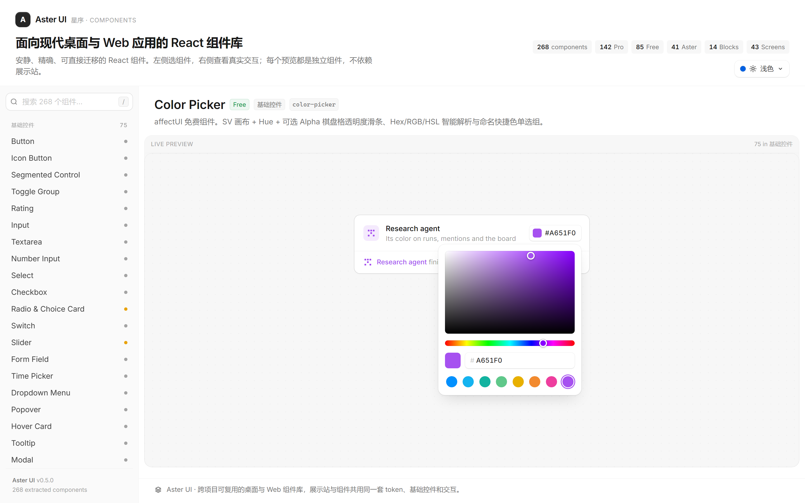
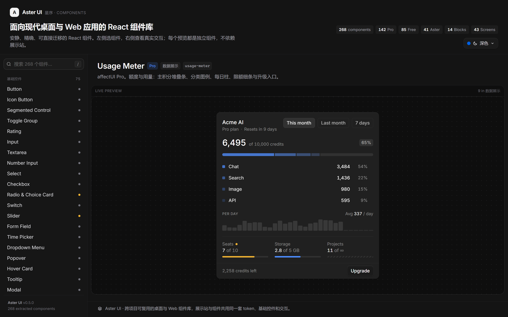

# Aster UI（星序）`v0.5.1`

1:1 对齐 [affectUI](https://www.affectui.com/components) Clean / Pro 交互、动效、无障碍与像素细节规范的通用 React 组件库（全库共 **259** 个独立组件与场景规格）。  
面向现代桌面工作台、AI 智能体协同、高信息密度 SaaS 与开发者工具，完整覆盖**基础布局与间距原语**、轻量化基础控件底座、复合业务模式、整页级应用界面、动态主题系统与 Electron 无边框窗口原语。

> **核心文档**：开发新界面前请阅读 [**DESIGN.md — 视觉令牌、基础组件间距与工程准则**](./DESIGN.md) 与 [**COMPONENTS.md — 全量组件清单与选型索引**](./COMPONENTS.md)。

## 预览





## v0.5.1 核心特性

- **259 个纯净通用组件与场景规格矩阵**：
  - **基础布局与语义间距原语（`@fangxinyan/aster-ui/core`）**：内置 `AfPage`、`AfPageHeader`、`AfSection`、`AfStack`、`AfInline`、`AfColumns`、`AfToolbar`、`AfListRow`、`AfSpacer` 与九级 `--af-space-*` 语义间距令牌，自动响应 `comfortable / compact` 密度缩放，解决纯基础组件拼装缺少间距与对齐规范的问题。
  - **基础控件与输入导航**：覆盖 `AfButton`、`AfInput`、`AfSelect`、`AfCombobox`、`AfCascader`、`AfDatePicker`、`AfDateRangePicker`、`AfDateTimeRangePicker`、`AfTimePicker`（含 `parseNaturalTime`）、`AfHotkeyInput`、`AfForm`、`AfTable` / `AfTablePro`、`AfTabs`、`AfTree`、`AfSteps`、`AfDiffView`、`AfMeterBar`、`AfStat`、`AfDescriptions`、`AfAppMark`、`AfOverflowTagList`、`AfCountdown`、`AfQrCodeCard`、`AfRating`、`AfColorPicker`、`AfModal`（含 `afModal` 命令式总线）、`AfDrawer`、`AfPopover`、`AfContextMenu`、`AfCommandPalette` 与桌面核心原语 `AfTitleBar` / `AfWindowControls` / `AfThemePanel`。
  - **AI 对话、数据展示与反馈**：覆盖 `AfChatComposer`、`AfAiAnswer`、`AfCitedAnswer`、`AfModelPicker`、`AfThinkingState` / `AfThinkingLoader`、`AfToolCallCard` / `AfToolCallGroup`、`AfBreakdownChart`、`AfUsageMeter`、`AfExperimentCard`、`AfDecisionInbox`、`AfNotificationStack`、`AfToaster` / `afToast` 与全局 `afMessage`。
  - **多智能体协同与治理（Agents Clean & Pro）**：完整收录 49 套智能体编排与审计组件（`AfAgentGraph`、`AfAgentLanes`、`AfAgentQueue`、`AfAgentTree`、`AfAutonomyDial`、`AfApprovalCard`、`AfReviewCenter`、`AfRunControls`、`AfDiffTimeline`、`AfRateLimitPlanner`、`AfConflictRadar`、`AfCostWaterfall`、`AfJudgeBracket`、`AfRootCauseTree`、`AfToolAccessMap`、`AfAgentCrew`、`AfAgentSequence`、`AfFlowBuilder` 等）。
  - **14 套高阶业务区块（Blocks）**：`AfLogoMarquee`、`AfTestimonialWall`、`AfKpiBoard`、`AfMetricsDashboard`、`AfInvoiceCredit`、`AfPricingPlans`、`AfAgentGallery`、`AfAppDirectory`、`AfClientContext`、`AfLiveSession`、`AfMissionControl`、`AfMissionTimeline`、`AfRunInspector`、`AfTaskBoard`。
  - **43 套整页级应用界面（Screens）**：涵盖双壳层（`AfAppShellInset`、`AfAppShellFlat`）、5 套引导流（`AfOnboarding*`）、9 套系统设置页（`AfSettings*`）、7 套工作空间页（`AfAnalytics`、`AfCrm`、`AfEvals`、`AfFiles`、`AfFolder`、`AfIntegrations`、`AfKanban`）、7 套 AI 助手对话页（`AfAssistant*`、`AfAgentChat*`、`AfAgentRun`、`AfAgentThread`）、7 套智能体运维治理页（`AfAgentActivity`、`AfAgentMemory`、`AfAgentPermissions`、`AfAgentSchedules`、`AfAgentSkills`、`AfAgentUsage`、`AfAgents`）与 6 套编排工作流页（`AfAgentInboxBoard`、`AfAgentOrchestration`、`AfAgentRunDetail`、`AfAgentTasks`、`AfInbox`、`AfWorkflowBuilder`）。
  - **8 套标志性动效原语 & 26 套交互式场景插画**：内置 `AfBlurCrossfade`、`AfNumberTicker`、`AfShimmerLoader`（及 `AfShimmerText` / `AfShimmerSkeleton`）、`AfTextReveal`、`AfGridBackground`、`AfGradientText`、`AfGradientFloor`、`AfTiltCard`，以及 `illustrations-a`（13 套）与 `illustrations-b`（13 套）共 26 套交互式插画。
- **双入口架构与 ESM + CJS 按需摇树（Tree-Shaking）**：
  - **模块结构保留构建**：输出 `dist/esm/**/*.js` + `.d.ts` 与 `dist/cjs/**/*.cjs` + `.d.cts`（保留完整中文 JSDoc 类型注释），原生兼容 `NodeNext`、`Bundler` 与 `Node10` 模块解析及组件级 Tree-Shaking。
  - **独立轻量核心包 `@fangxinyan/aster-ui/core`**：映射至 `dist/esm/ui.js` 与 `dist/cjs/ui.cjs`，内置完整基础控件、`AsterThemeProvider` / `useAsterTheme`、`AfTitleBar` / `AfWindowControls` / `AfThemePanel`、`cn` 与安全异步剪贴板原语 `copyToClipboard`，零依赖图表或重型复合模式。
  - **细粒度子路径与按需样式**：提供 `@fangxinyan/aster-ui`、`@fangxinyan/aster-ui/runtime`（零样式副作用纯 JS 运行时与动态插件桥接入口）、`@fangxinyan/aster-ui/core`、`@fangxinyan/aster-ui/ui-pro`、`@fangxinyan/aster-ui/theme`、`@fangxinyan/aster-ui/primitives`、`@fangxinyan/aster-ui/icons`、`@fangxinyan/aster-ui/motion`、`@fangxinyan/aster-ui/patterns/*` 与 `@fangxinyan/aster-ui/examples`；样式支持全量 `@fangxinyan/aster-ui/styles.css` 或以 `@fangxinyan/aster-ui/tokens.css` + `@fangxinyan/aster-ui/core.css` 为底座按需叠加 `@fangxinyan/aster-ui/patterns/*.css`、`@fangxinyan/aster-ui/screens/*.css`、`@fangxinyan/aster-ui/illustrations/*.css`。
- **严格作用域隔离、SSR 安全与无障碍契约**：
  - 全部组件库样式严格收口于 `.af` 作用域内（零全局 `:root` 或裸 `.dark` 污染），所有 `blur(...)` 滤镜均包裹于 `@media (prefers-reduced-motion: no-preference)` 减动效门禁中，容器边线遵循整数 `1px` 防亚像素消失规范，且全量零必填属性组件均通过零警告 Node SSR 静态渲染校验。

## 安装与快速开始

```bash
npm install @fangxinyan/aster-ui
```

### 1. 全量引入（推荐快速接入）

```tsx
import "@fangxinyan/aster-ui/styles.css";
import {
  AsterThemeProvider,
  AfButton,
  AfForm,
  AfFormItem,
  AfInput,
  AfTitleBar,
  afMessage,
} from "@fangxinyan/aster-ui";

export function App() {
  return (
    <AsterThemeProvider
      defaultMode="system"
      defaultAccent="blue"
      defaultDensity="comfortable"
      defaultRadius="md"
    >
      <AfTitleBar title="Aster Workbench" />
      <AfForm onFinish={() => afMessage.success("保存成功")}>
        <AfFormItem name="host" label="网关主机" rules={[{ required: true, message: "请输入主机地址" }]}>
          <AfInput placeholder="api.aster.local" allowClear />
        </AfFormItem>
        <AfButton type="submit" variant="primary">
          保存配置
        </AfButton>
      </AfForm>
    </AsterThemeProvider>
  );
}
```

### 2. 轻量底座与按需子路径样式引入

仅使用基础控件与窗口壳层时，可直接引入 `@fangxinyan/aster-ui/core` 与 `@fangxinyan/aster-ui/core.css`；当需要叠加特定复合模式、整页 Screen 或交互插画时，在 `@fangxinyan/aster-ui/tokens.css` + `@fangxinyan/aster-ui/core.css` 基础上按需引入对应子路径 CSS 即可：

```tsx
import "@fangxinyan/aster-ui/tokens.css";
import "@fangxinyan/aster-ui/core.css";
import "@fangxinyan/aster-ui/patterns/chat.css";
import "@fangxinyan/aster-ui/screens/screens-chat.css";
import "@fangxinyan/aster-ui/illustrations/illustrations-a.css";

import { AsterThemeProvider, AfTitleBar, AfButton, copyToClipboard } from "@fangxinyan/aster-ui/core";
import { AfChatComposer } from "@fangxinyan/aster-ui/patterns/chat";
import { AfIntegrationBeam } from "@fangxinyan/aster-ui";

export function LightweightChatHost() {
  return (
    <AsterThemeProvider initialMode="dark" initialAccent="violet">
      <AfTitleBar
        title="Agent Studio"
        actions={
          <AfButton size="xs" onClick={() => void copyToClipboard("https://aster.local")}>
            复制连接地址
          </AfButton>
        }
      />
      <AfIntegrationBeam />
      <AfChatComposer placeholder="输入指令或 @ 调用工具…" />
    </AsterThemeProvider>
  );
}
```

### 3. 主题运行时调控（`useAsterTheme`）

`useAsterTheme()` 提供完整的明暗模式、强调色、密度、圆角及自定义主题增删改查能力：

```tsx
import { useAsterTheme } from "@fangxinyan/aster-ui";

export function ThemeQuickControls() {
  const {
    mode,
    resolved,
    modality,
    accent,
    density,
    radius,
    themes,
    activeThemeId,
    setMode,
    setAccent,
    setDensity,
    setRadius,
    applyTheme,
    saveTheme,
    deleteTheme,
    cycleMode,
    container,
    portalRoot,
  } = useAsterTheme();

  return (
    <div data-resolved={resolved} data-modality={modality} data-themes={themes.length}>
      <button type="button" onClick={cycleMode}>
        当前模式：{mode}（强调色：{accent} / 密度：{density} / 圆角：{radius}）
      </button>
      <button
        type="button"
        onClick={() => {
          setMode("dark");
          setAccent("violet");
          setDensity("compact");
          setRadius("sm");
          applyTheme({ mode: "dark", accent: "violet", density: "compact", radius: "sm" });
          const saved = saveTheme({ name: "紧凑夜色", mode: "dark", accent: "violet" });
          if (activeThemeId && activeThemeId !== saved.id) {
            deleteTheme(activeThemeId);
          }
        }}
      >
        保存并切换预设（宿主就绪：{Boolean(container && portalRoot) ? "是" : "否"}）
      </button>
    </div>
  );
}
```

- 顶部轻提示 `afMessage.info / success / warning / error / loading / destroy` 已由 `AsterThemeProvider` 自动挂载至 `.af-portal-root`，开箱即用。
- 常见语义与工程图标别名（如 `AppstoreOutlined`、`unorderedList`、`reload`）已通过 `AF_ICON_ALIASES` 内置映射至 `AfIcon`。

### 4. 多窗口透明宿主与动态插件桥接（`@fangxinyan/aster-ui/runtime`）

针对由宿主 `<link>` 控制样式顺序的多窗口桌面应用、透明悬浮子窗口以及独立 `createRoot` 动态插件，可使用无样式副作用的 `@fangxinyan/aster-ui/runtime` 与 `createAsterPluginRuntime()` 共享同一主题上下文、浮层根与 `afMessage` 通知队列：

```tsx
import * as AsterUIRuntime from "@fangxinyan/aster-ui/runtime";
import {
  AsterThemeProvider,
  AfButton,
  AfPluginProvider,
  createAsterPluginRuntime,
  afMessage,
} from "@fangxinyan/aster-ui/runtime";

const pluginRuntime = createAsterPluginRuntime({
  ui: AsterUIRuntime,
  globalKey: "__asterPluginShared",
});

export function TransparentOverlayWindow() {
  return (
    <AsterThemeProvider
      mode="dark"
      accent="violet"
      transparent
      target="document"
      storage={false}
    >
      <AfPluginProvider runtime={pluginRuntime} pluginId="quick-assistant">
        <AfButton onClick={() => afMessage.info("跨根节点共享浮层与通知队列")}>
          触发插件轻提示
        </AfButton>
      </AfPluginProvider>
    </AsterThemeProvider>
  );
}
```

## 开发、测试与质量门禁

```bash
npm run lint:arch          # 12 项架构与 affectUI 样式铁律扫描（禁 Grid、禁斑马纹、.af 作用域收口、Blur 门禁等）
npm run typecheck          # TypeScript 严格类型校验（覆盖 src/ 与 tests/ 全量测试代码）
npm run build              # 构建 dist/ ESM + CJS 双格式、保留 JSDoc 的 .d.ts/.d.cts 与全量按需 CSS
npm run check:pkg          # 7 项发包门禁（Tarball 白名单、exports 全量解析、全组件零警告 SSR、README 代码实编与摇树体积）
npm run build:showcase     # 打包自包含组件展示站 index.html
npm run test               # 运行 Vitest 契约测试与无头 Chrome 真实 DOM 交互测试
npm run visual:update      # 生成全量组件 Light/Dark 视觉基线
npm run visual:check       # 像素级比对视觉基线
npm run visual:theme:check # 复验 5 种强调色 × 2 主题矩阵
```

## 进一步阅读

- [**DESIGN.md**](./DESIGN.md)：affectUI Clean / Pro 视觉令牌、基础组件间距与布局配方、无障碍铁律及组件 API 速查对照表。
- [**COMPONENTS.md**](./COMPONENTS.md)：全量组件分层目录与选型索引。
- [**CHANGELOG.md**](./CHANGELOG.md)：版本演进记录与发布说明。
- [**INTER-LICENSE.txt**](./assets/INTER-LICENSE.txt)：内嵌 Inter 可变字体开源许可说明。
